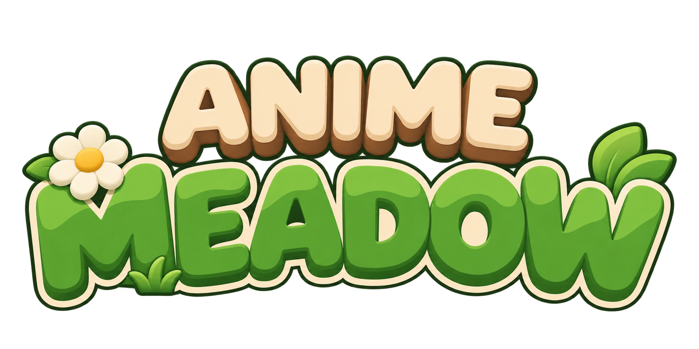

<div align="center">



A meadow that never ends

[中文](README.md) | English | [Русский](README.ru.md)


</div>

## About

AnimeMeadow is a toon-shaded wandering game

There are no quests and no enemies. You are a little traveler with a backpack, strolling across a meadow that sways in the wind
Listen to birds in the morning, chase butterflies at dusk, watch fireflies at night. Pet the rabbits, feed carrots to the deer, or sit by a pond and fish

Walk far enough and the meadow turns into autumn woods, cherry blossom groves, snowy pine forests, frozen lakes or desert

<div align="center">

 
 

</div>

## Features

- Infinite procedurally generated world, every seed is different
- Six biomes: meadow, autumn woods, cherry blossom grove, snowfield, ice field, desert
- Day and night cycle with weather, auroras over the snowfield at night
- Rabbits, deer and birds follow you once you pet or feed them
- Butterfly catching, fishing, footprints in the snow, visible breath in winter
- The hero has no mouth, all expression is in the eyes
- Minimap and fog of exploration
- Wind, birdsong, insects and water sounds change with time and place

## Controls

| Key | Action |
|---|---|
| W A S D or arrow keys | Move |
| Mouse | Look |
| Shift | Run |
| Space | Jump |
| E | Pet, feed |
| 1 to 4 | Switch held item |
| B | Backpack |
| M | World map |
| V | First person / third person |
| Mouse wheel | Camera distance |
| Hold T | Fast forward time |
| F11 | Fullscreen |
| Esc | Pause and settings |

## Running

Open project.godot in Godot 4.7 and press F5

To export, use Project > Export > Windows Desktop, output goes to the build folder

## Layout

```
scripts       game code
shaders       shaders
characters    hero and animal models
props         prop models
audio         sounds, sources in audio/CREDITS.txt
art/branding  logo and icons
```

Dev notes are in [HANDOFF.md](HANDOFF.md) (Chinese)

## Author

xiaomao8090

## Credits

Ambient and footstep sounds from [BBC Sound Effects](https://sound-effects.bbcrewind.co.uk), personal use only under the RemArc license

Engine: [Godot Engine](https://godotengine.org)

## Copyright

© 2026 xiaomao8090 All rights reserved

Audio assets may not be used commercially or redistributed
