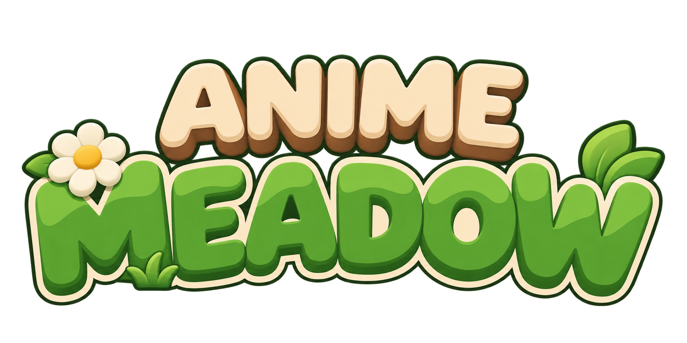

<div align="center">



Луг, которому нет конца

[中文](README.md) | [English](README.en.md) | Русский


</div>

## Об игре

AnimeMeadow это неспешная игра-прогулка в мультяшной стилистике

Здесь нет заданий и нет врагов. Вы маленький путник с рюкзаком, который просто гуляет по лугу, колышущемуся на ветру
Утром слушайте птиц, вечером гоняйтесь за бабочками, ночью смотрите на светлячков. По пути можно погладить кролика, угостить оленёнка морковкой или посидеть у пруда с удочкой

Если уйти подальше, луг сменится осенним лесом, сакуровой рощей, заснеженным сосновым бором, замёрзшим озером или пустыней

<div align="center">

 
 

</div>

## Что есть в игре

- Бесконечный случайно генерируемый мир, каждый сид не похож на другой
- Шесть биомов: луг, осенний лес, сакуровая роща, снежная равнина, ледяное поле, пустыня
- Смена дня и ночи и погода, ночью над снежной равниной северное сияние
- Кролики, олени и птицы идут за вами, если их погладить или покормить
- Ловля бабочек, рыбалка, следы на снегу, пар изо рта зимой
- У героя нет рта, все эмоции видны по глазам
- Миникарта и туман неисследованных мест
- Ветер, птицы, насекомые и вода звучат по-разному в зависимости от времени и места

## Управление

| Клавиша | Действие |
|---|---|
| W A S D или стрелки | Движение |
| Мышь | Обзор |
| Shift | Бег |
| Пробел | Прыжок |
| E | Погладить, покормить |
| От 1 до 4 | Сменить предмет в руке |
| B | Рюкзак |
| M | Большая карта |
| V | Вид от первого или третьего лица |
| Колесо мыши | Отдаление камеры |
| Удерживать T | Ускорить время |
| F11 | Полный экран |
| Esc | Пауза и настройки |

## Запуск

Откройте project.godot в Godot 4.7 и нажмите F5

Экспорт: Проект > Экспорт > Windows Desktop, результат появится в папке build

## Структура

```
scripts       код игры
shaders       шейдеры
characters    модели героя и животных
props         модели предметов
audio         звуки, источники в audio/CREDITS.txt
art/branding  логотип и иконки
```

Заметки разработки в [HANDOFF.md](HANDOFF.md) (на китайском)

## Автор

xiaomao8090

## Благодарности

Фоновые звуки и звуки шагов взяты из [BBC Sound Effects](https://sound-effects.bbcrewind.co.uk), только для личного использования по лицензии RemArc

Движок: [Godot Engine](https://godotengine.org)

## Авторские права

© 2026 xiaomao8090 Все права защищены

Аудиоматериалы нельзя использовать в коммерческих целях и распространять повторно
